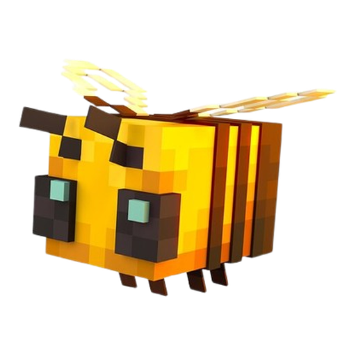

<p align="center">
  
  <br />
  <strong>Bee Launcher</strong>
</p>

# Bee Launcher

**Version 0.1.33** · Tauri 2 · Windows-first Minecraft: Java Edition launcher

Bee Launcher finds Minecraft Java profiles already installed on your PC and launches the one you choose. It also provides isolated modpack profiles, local world backups, launcher customization, and troubleshooting helpers. It is an independent project—not an official Mojang or Microsoft launcher.

> The bee PNG in this README is a copy of the existing Windows app icon. The Minecraft wordmark remains a separate logo in the launch screen; neither brand asset has been redesigned.

## Features

- **Find and launch local profiles.** Bee scans an existing `.minecraft` folder, detects profiles from their local metadata, and lets you choose a profile before starting it. Automatic folder discovery considers the contents of common Windows Minecraft locations; you can also select a folder yourself. Main Play and Quick Play start the selected profile directly.
- **Choose compatible Java and performance settings.** Bee detects installed Java runtimes and checks a profile's required Java major version. You can choose a Java executable and memory limit per profile, set a default memory limit, and configure the game resolution and fullscreen mode. An optional Intel UHD low-impact graphics preset is off by default and restores the saved graphics options when returned to the default preset.
- **Share game files without mixing packs.** Imported profiles use Bee Launcher's shared `assets`, `libraries`, and `versions` store. Each profile still has separate `mods`, `config`, `saves`, resource packs, shaders, launch options, logs, and native libraries. Bee copies common files from an existing `.minecraft` folder into its own store; it never hard-links back to or writes into that original folder. Existing imported profiles migrate only when any same-named common files are byte-identical; if files conflict, that profile's original runtime is left in place.
- **Import isolated modpacks.** Import Modrinth format-v1 `.mrpack` packs, standard CurseForge Minecraft modpack `.zip` exports, or an offline Bee Launcher bundle `.zip`. Vanilla, Fabric, Quilt, Forge, and NeoForge are supported with one loader per pack. CurseForge dependencies are resolved by their exact project/file IDs through the public HTTPS file API and verified against the returned file sizes. Resource packs and shader files go into their profile-local folders using the categories in the export's `modlist.html`. Modrinth downloads retain manifest-hash verification. Forge and NeoForge may use their official client installers when no matching profile is already available. Imported instances live in Bee Launcher's app-data folder, not in the selected `.minecraft` folder.
- **Keep a local skin library.** Add 64×64 or legacy 64×32 skin PNGs, select a launcher avatar, and view the active skin as an animated, mouse-interactive 3D character. Skin images stay on the PC.
- **Back up and review worlds.** Create local ZIP backups for a selected profile's saves. Before a restore, Bee previews the worlds and name conflicts; replacing an existing world first creates a separate safety backup. Close Minecraft before restoring.
- **Get launch-log guidance.** A rule-based helper reads the recent local launch log and offers likely causes and next steps. It is not an online or AI diagnosis service; the displayed excerpt is redacted for common secret-like fields.
- **Customize the launcher.** Choose a built-in or local wallpaper, accent color, panel opacity, and brightness. Settings remain local, and Bee remembers the launcher's normal window size.
- **Browse news and release notes.** Minecraft News is fetched only when requested, using Minecraft.net's official page with its official RSS feed as a fallback. Bee keeps the most recently fetched articles for offline viewing. Bee Patch Notes are a separate, locally bundled release history.

## Important limitations and verification notes

- Bee uses a **local player name and offline UUID**. It does not sign into Microsoft or TLauncher accounts, read their sign-in tokens, or support Realms or servers that require authenticated accounts. Missing game files may still need to be downloaded before a profile can start.
- Modpack import supports **Modrinth format version 1**, standard **CurseForge Minecraft modpack ZIP exports**, and Bee Launcher bundles, with vanilla or exactly one of Fabric, Quilt, Forge, or NeoForge. Modrinth and CurseForge imports need internet access for missing game files or external dependencies; CurseForge uses the export's project/file IDs and mod-list ordering to put mods, resource packs, and shaders in separate folders. Bee bundle ZIP imports remain offline but require a matching Minecraft/loader profile already installed locally and every client file listed in the manifest inside the ZIP. Other archive formats, future/custom loader IDs, and packs pinning multiple loaders are not supported. CurseForge's metadata API does not provide a content hash in every file response, so Bee verifies the exact pinned IDs and advertised file sizes rather than claiming a manifest checksum. When a pinned file is marked client-compatible but omits the pack's exact Minecraft version tag, Bee preserves it and shows a compatibility warning rather than silently swapping or skipping that file.
- **In-game skin application is conditional and has not been confirmed working on the target Windows PC.** It requires a Minecraft 26.3 Fabric profile with CustomSkinLoader 15.1 or later already installed. Bee stages the PNG and prepares/checks the loader's LocalSkin configuration; this alone does not prove Minecraft displayed the skin. The loader log must confirm it after Minecraft has been fully restarted and a world opened. This is a local-client skin, not an account skin, and other players will not see it.
- **A successful Minecraft News request has not been confirmed on the target Windows PC.** The Windows build has an implementation for the current Windows proxy settings, and it falls back to the official RSS feed and saved articles, but the request can still fail on a particular network or PC. If it does, use the page's browser link or the saved articles when available.
- World backups are stored locally on the same PC. They are not cloud-synced; keep another copy elsewhere if you need protection against device or drive loss.

## Build on Windows

### Prerequisites

Install Node.js, pnpm, Rust, Microsoft C++ Build Tools (including **Desktop development with C++**), and WebView2.

### Run the development build

```powershell
pnpm install
pnpm tauri:dev
```

To build the frontend alone:

```powershell
pnpm build
```

### Package installers

```powershell
pnpm tauri:build
```

Tauri is configured to produce NSIS and MSI installers. Build outputs are placed under `src-tauri/target/release/bundle/`.

## Project structure

- `src/` — Vite frontend, launcher UI, styling, and interactive skin preview.
- `src-tauri/` — Tauri 2 Rust backend, launcher commands, modpack imports, crash-log helper, and world backup/restore code.
- `src-tauri/icons/icon.png` and `src-tauri/icons/icon.ico` — existing Bee app icons used for the Windows app identity and installers.
- `src/assets/minecraft-logo.svg` — Minecraft wordmark displayed in the launcher UI.
- `assets/bee-launcher-icon.png` — reusable transparent PNG copy of the app icon for this README and other project materials.

## What to build next (ranked)

1. **Add a Java runtime manager.** Offer a clear way to install or repair a compatible Java version when none is found, while retaining Bee's existing per-profile Java selection.
2. **Manage imported profiles.** Add safe rename, duplicate, delete, and disk-usage actions, with explicit confirmation and protection for each instance's saves.
3. **Add modpack update and rollback support.** Compare an update before applying it, preserve the previous instance, and make it easy to return to the old pack if an update breaks it.
4. **Offer scheduled backups and retention controls.** Let players choose backup timing, destination, and how many local copies to keep, alongside the existing manual preview-and-restore flow.
5. **Add optional official Microsoft account sign-in.** This could enable authenticated servers and account skins, but should be a later, carefully scoped feature using Microsoft's supported OAuth flow and secure token storage—not by reading another launcher's credentials.

Separately from these feature ideas, verify the existing News fetch and in-game skin path on the target Windows setup before describing either as confirmed working.

## Minecraft trademark

Minecraft is a trademark of Mojang Studios. Bee Launcher is an independent project and is not affiliated with or endorsed by Mojang or Microsoft.
